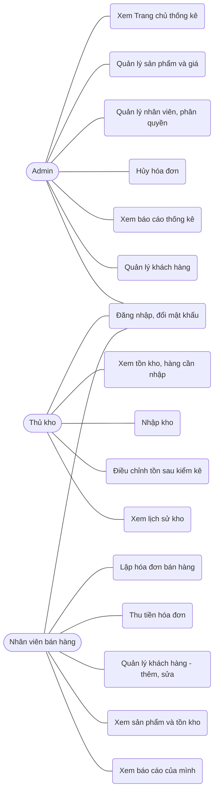

# Hướng dẫn chạy và demo - Hệ thống Quản lý bán hàng

## 1. Cài đặt (làm đúng thứ tự)
1. Mở **SSMS**, kết nối vào server SQLEXPRESS của bạn.
2. `File > Open > File...` chọn **QuanLyBanHang.sql** rồi bấm **Execute (F5)**. Cuối cùng phải thấy dòng `Đã tạo xong database QuanLyBanHang.` (Chạy lại bao nhiêu lần cũng được, script tự xóa DB cũ.)
3. Mở file `BaiTapLon/server.txt`, ghi tên server giống hệt tên bạn thấy khi connect trong SSMS (ví dụ `DESKTOP-ABC\SQLEXPRESS`). Nếu đang là `.\SQLEXPRESS` và chạy được thì không cần sửa.
4. Mở `BaiTapLon.csproj` bằng Visual Studio 2022/2026, bấm **F5**. Lần build đầu cần Internet để tải gói `Microsoft.Data.SqlClient`.
5. Nếu báo "Không kết nối được SQL Server", làm theo 3 gợi ý trong hộp thoại (đã chạy .sql chưa, tên server, dịch vụ SQL Server).

## 2. Tài khoản thử
| Tài khoản | Mật khẩu | Vai trò |
|---|---|---|
| admin | admin123 | Admin |
| thukho | kho123 | Thủ kho |
| nam, tuan | 123456 | Nhân viên bán hàng |
| huy | 123456 | Thủ kho (đã khóa, để thử thông báo khóa) |

## 3. Phân quyền theo 3 vai trò (đối chiếu yêu cầu thầy)
| Chức năng | Admin | Thủ kho | Nhân viên bán hàng |
|---|:-:|:-:|:-:|
| Trang chủ | Tất cả số liệu | Chỉ số lượng tồn, hàng cần nhập | Số liệu của riêng mình |
| Doanh thu, lãi gộp, tiền nhập, giá nhập | Có | **Không thấy** | Không (chỉ doanh thu của mình) |
| Sản phẩm: thêm/sửa/giá/ngừng KD | Có | Không | Chỉ xem (không thấy giá nhập) |
| Kho hàng, Lịch sử kho | (trong Quản lý sản phẩm) | Có | Không |
| Nhập kho, điều chỉnh tồn | Có | Có | Không |
| Lập hóa đơn, thu tiền | Không | Không | Có |
| Hủy hóa đơn | Có (bắt buộc lý do) | Không | Không |
| Khách hàng | Đầy đủ | Không | Xem, thêm, sửa |
| Nhân viên, tài khoản | Có | Không | Không |
| Báo cáo thống kê | Toàn cửa hàng | Không | Của riêng mình |

Trang chủ Admin: doanh thu tháng và hôm nay, tiền nhập tháng, lãi gộp tạm tính, số hóa đơn tháng, tổng doanh thu, tổng tiền nhập, giá trị tồn kho, **toàn bộ hàng hết/sắp hết kèm gợi ý số lượng nhập**, biểu đồ doanh thu 6 tháng, top bán chạy tháng, hóa đơn gần đây.
Trang chủ Thủ kho: hết hàng, sắp hết, số mặt hàng, số lượng đã nhập trong tháng, danh sách hàng cần nhập, biến động kho gần đây. Không có đồng tiền nào.

## 4. Biểu đồ use case (dán vào https://mermaid.live để xuất ảnh)

## 5. Mô hình DISCONNECTED (trả lời câu "server luôn mở là connected")
- **Đọc**: `Store.Load()` gọi `SqlDataAdapter.Fill()` đổ các bảng vào `DataSet`; kết nối được mở rồi đóng ngay trong lệnh Fill. Sau đó toàn bộ giao diện làm việc trên dữ liệu trong bộ nhớ.
- **Ghi**: mỗi thao tác (lập hóa đơn, nhập kho, sửa sản phẩm...) mở kết nối, chạy trong **một SqlTransaction** (lỗi giữa chừng thì ROLLBACK), rồi đóng kết nối ngay. Không có kết nối nào giữ mở suốt chương trình.
- Chi tiết nằm ở `Db.cs` và `Models.cs`.

## 6. Kịch bản demo input -> output cho thầy
1. Đăng nhập **admin**: Trang chủ ghi nhận doanh thu tháng, tiền nhập tháng, danh sách hàng cần nhập (Tai nghe Gaming H7 hết hàng, Router, USB, Chuột sắp hết). *Ghi lại* số "Tiền nhập hàng tháng này" và "Chuột không dây M220 - tồn 4".
2. Đăng xuất, đăng nhập **thukho**: Trang chủ chỉ có số lượng. Vào **Kho hàng**, chọn Chuột không dây M220 > **Nhập kho** 10 cái. Tồn thành 14, trạng thái "Còn hàng". Mở **Lịch sử kho** thấy dòng nhập mới. Thủ kho không thấy giá ở bất kỳ đâu.
3. Đăng nhập **nam**: **Bán hàng**, chọn khách hàng KH001, thêm 2 Bàn phím cơ K500, chọn **Thanh toán** (Tiền mặt). Output: hóa đơn mới, tồn Bàn phím giảm 2.
4. Đăng nhập lại **admin**: Trang chủ tăng doanh thu 1.700.000 đ, tiền nhập tháng tăng 2.000.000 đ (10 x giá nhập 200.000), hàng cần nhập giảm 1 dòng. Có thể hủy hóa đơn vừa lập (nhập lý do) để thấy kho được hoàn.
5. Trong SSMS chạy `SELECT * FROM HoaDon ORDER BY NgayLap DESC;` để chứng minh dữ liệu thật sự nằm trong SQL Server.

## 7. Lưu ý
- Mật khẩu lưu SHA-256 (không muối), phù hợp mức bài tập lớn; hệ thống thật nên dùng PBKDF2/bcrypt.
- Bảng `DonHang`, `PhieuXuat` giữ theo thiết kế ban đầu nhưng form hiện chưa dùng.
- Lãi gộp là ước tính: doanh thu trừ (số lượng bán x giá nhập hiện tại của sản phẩm).
